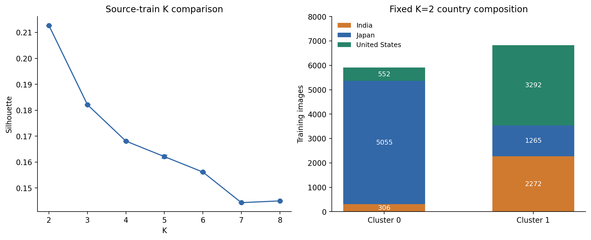

# 潜在域发现与对应训练

本方案以源训练图像的冻结骨干通道统计构建外观表示，在不使用目标测试数据的条件下确定潜在域数量和固定硬划分，再比较国家域与潜在域的专家对抗训练。潜在域是该表示空间中的数据分组，不是病害类别，也不保证与国家因素独立。

## 数据流与实际产物

| 环节 | 当前文件/入口 | 输入 → 输出 |
|---|---|---|
| 冻结协议 | [config.py](../../stage0-latent_domain_analysis/config.py) | 国家、训练张数、K范围、种子、最终K |
| 训练表示提取 | [extract_features.py](../../stage0-latent_domain_analysis/extract_features.py) | 原始单国训练TXT → `features/style_features.npy`、`metadata.csv` |
| K比较 | [select_k.py](../../stage0-latent_domain_analysis/select_k.py) | 256维表示 → scaler、各K候选、评估CSV |
| 解释与最终划分 | [analyze_clusters.py](../../stage0-latent_domain_analysis/analyze_clusters.py) | 候选/已确认K → 标签、中心、组成与代表图 |
| 稳健性 | [robustness_checks.py](../../stage0-latent_domain_analysis/robustness_checks.py) | 缓存特征 → 子集评估和80%重采样结果 |
| 源验证表示 | [extract_val_features.py](../../stage0-latent_domain_analysis/extract_val_features.py) | 源验证TXT → 同提取器验证表示 |
| 清单导出 | [export_domain_splits.py](../../stage0-latent_domain_analysis/export_domain_splits.py) | 固定训练中心 → 训练/验证单簇TXT与合并TXT |

源训练集为India 2,578、Japan 6,320、United States 3,844，共12,742张；源验证集分别322、790、480，共1,592张。训练比例保持原样，不为聚类做国家均衡。原始国家/检测标注用于路径审计及聚类解释，不输入K-means目标。

## 1. 风格表示与标准化

固定`model_data/yolov8_s.pth`中的YOLOv8-s骨干，严格加载骨干权重，eval、冻结、FP32。图像RGB、BICUBIC直接缩放至640×640、除以255，不作训练增强。

设骨干dark3输出为 $A(x)\in\mathbb R^{128\times80\times80}$，$M=6400$。第$c$通道统计为：

$$
\mu_c(x)=\frac1M\sum_{u=1}^{M}A_{cu}(x),\qquad
\sigma_c(x)=\sqrt{\frac1{M-1}\sum_{u=1}^{M}(A_{cu}(x)-\mu_c(x))^2}.
$$

拼接 $s(x)=[\mu(x);\sigma(x)]\in\mathbb R^{256}$。注意图像内的标准差采用`correction=1`。随后`StandardScaler`仅在全部源训练表示上拟合；它对每个坐标使用训练总体统计，与上面的空间样本标准差是两层不同的计算。

$$z_j(x)=(s_j(x)-m_j)/a_j.$$

`scaler_mean.npy`、`scaler_scale.npy`与`cluster_centers.npy`共同决定域分配；不能只拿中心对原始256维向量求距离。提取代码仅在独立提取进程中替换冗余的硬编码设备搬运，卷积/BN/激活计算保持原定义。

## 2. K的选择与固定标签

每个 $K\in\{2,3,4,5,6,7,8\}$，执行五个种子0～4、每次`n_init=10`的K-means++/Lloyd拟合，`max_iter=300`、`tol=1e-4`：

$$\min_{\{c_i\},\{v_k\}}\sum_i\|z_i-v_{c_i}\|_2^2.$$

每个K保存五次运行中inertia最低的候选。评价使用同一固定种子3407抽取的5,000张训练图片计算Silhouette；CH、DB和占比使用全部训练图；五个完整标签之间计算10对ARI。GMM使用对角协方差、3次初始化，BIC作为单独的模型参考。

K=2的初轮Silhouette约0.212708、CH约3848.98、DB约1.752818、初始化ARI约0.999686。K=2优于其他候选的Silhouette/CH/DB；GMM-BIC则随K继续下降，因此不能宣称所有准则一致指向K=2。

补充实验包括：10组各5,000张评估子集；10组80%源训练重采样（10,194张），固定K-means种子0，每次拟合后为全部12,742张图片分配标签。K=2在两种比较中均为10/10次Silhouette第一，重采样运行间ARI为0.991460±0.003076。完整数字见[原始K报告](../../stage0-latent_domain_analysis/results/K选择报告.md)。

最终经确认固定K=2，用已审阅候选的**种子2**重新拟合并验证标签一致。这里的种子2是最终聚类种子，不是后续检测训练的seed=11。

| 固定簇 | India训练 | Japan训练 | US训练 | 训练合计 | 源验证合计 |
|---|---:|---:|---:|---:|---:|
| Cluster_0 | 306 | 5,055 | 552 | 5,913 | 738 |
| Cluster_1 | 2,272 | 1,265 | 3,292 | 6,829 | 854 |

源验证图像使用同一冻结提取器，再用训练scaler和训练中心最近邻分配；不重新拟合、不参与K选择。最终训练标签见[final_cluster_labels.csv](../../stage0-latent_domain_analysis/results/final_cluster_labels.csv)，确认记录见[final_k_decision.json](../../stage0-latent_domain_analysis/results/final_k_decision.json)。

## 3. 清单格式与采样预算

单簇TXT每行是`图像绝对路径 x1,y1,x2,y2,class ...`，四类为D00、D10、D20、D40。`combined_train.txt`每行用`&`连接Cluster_0/1样本，循环短簇至长簇长度6,829：共13,658次图片出现，Cluster_0额外重复916次。`combined_val.txt`为两簇源验证的单图并集，无`&`、无重复。

**Unique不是重写TXT。** `prepare_data()`先从配对TXT构建按规范路径索引的记录和域归属，再将去重路径排序为单图行；国家Unique与潜在Unique遍历同一12,742张图，仅域ID不同。`owners`来自配对TXT槽位，阶段2的`audit_source_labels()`再与CSV逐项核对。

| 第一阶段实验 | 组成 | 每轮图片出现次数 | 每轮步数（总batch12） |
|---|---|---:|---:|
| baseline | 国家配对采样、仅检测 | 18,960 | 1,580 |
| country_repeat | 国家三域、专家对抗+Triplet | 18,960 | 1,580 |
| latent_repeat | 潜在两域、专家对抗+Triplet | 13,658 | 1,139 |
| country_unique | 国家三域、专家对抗+Triplet | 12,742 | 1,062 |
| latent_unique | 潜在两域、专家对抗+Triplet | 12,742 | 1,062 |

Repeat组除域标签外还改变了重复比例和更新预算；Unique配对更直接控制图片预算，但国家K=3与潜在K=2同时改变专家数和Triplet域池。

## 4. 专家与共享Student训练

专家产物位于项目外的[expert_pretrain_20261004_200ep](../../../yolov8-pretrain/results/expert_pretrain_20261004_200ep/README.md)。原专家训练为200轮、batch16、seed11，仅检测损失；各专家独立从同一预训练文件初始化，best按完整对应源验证检测loss选择。

| 专家 | best轮次 | 实际使用权重 |
|---|---:|---|
| Japan / India / United States | 32 / 33 / 42 | 对应目录`best_epoch_weights.pth` |
| Cluster_0 / Cluster_1 | 39 / 52 | 对应目录`best_epoch_weights.pth` |

Cluster_1训练在第166轮中止，使用已确认的第52轮best，而不是把其last当作200轮权重。Student训练只加载各专家backbone，专家冻结且eval，用作特征参考；它们不参与最终推理。专家训练过程与本项目后续Student训练是不同阶段。

专家实际入口另存于[专家仓库的train_style_single快照](../../../yolov8-pretrain/results/expert_pretrain_20261004_200ep/source_snapshot/train_style_single.py)，训练循环为同快照`utils/utils_fit_single.py`。专家预训练的增强配方与Student不同：Mosaic开启、概率0.5、只在前50%训练阶段启用，MixUp关闭；SGD的记录名义LR为0.01、最低0.0001，按batch16/64拟合为0.0025/0.000025。输入640、workers8、FP32、不冻结，关闭FFT/MixStyle。初始化文件在专家仓库`model_data/yolov8_s.pth`。重建专家时应读取其各自run_config和快照，不照搬Student关闭Mosaic的配方。

五组Student原运行均为100轮、seed11、总batch12、SGD、640输入、FP32、无冻结；关闭Mosaic/MixUp/FFT/MixStyle，保留单图几何/颜色增强。真实代码为[S1 comparison_training快照](../../stage1-latent-domain/comparison_20261005_100ep/source_snapshot/utils/comparison_training.py)，多专家损失和更新细节见[02](02_Kway替换方案.md)。

## 解释边界

簇0有85.49%日本图像，两簇的病害实例比例也不同。均值/标准差表示可能同时编码外观、背景、视角和语义组成。当前证据支持“基于通道统计的潜在划分”，不支持“纯风格解耦”或“检测最优的K”。K选择稳健性与下游精度优势是两条独立证据，后者须使用[实验结果](04_实验结果与论文表述.md)单独评价。
