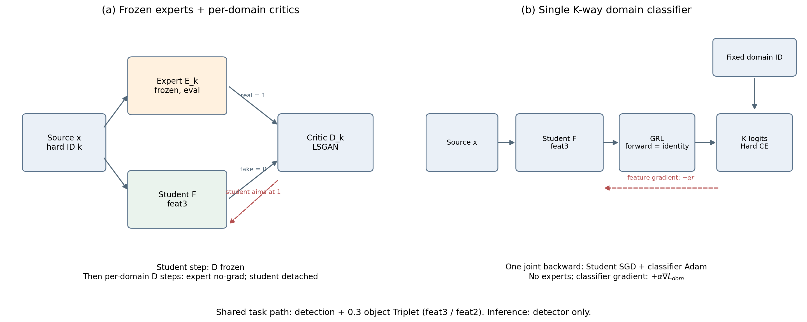

# 多专家对抗模块与单 K-way 替换

对照保持检测Student和Triplet实现，以单K类域分类器替换全部“冻结专家+逐域二元判别器”模块。国家分组K=3，潜在分组K=2。K表示域数，与检测任务的四个病害类别不是同一维度。

| 组别 | 域划分 | 专家 | 域判别器 | 对抗机制 |
|---|---|---:|---|---|
| 01 | 国家 | 3 | 3个Patch二元判别器 | 专家/学生LSGAN |
| 02 | 固定潜在域 | 2 | 2个Patch二元判别器 | 专家/学生LSGAN |
| 03 | 国家 | 0 | 1个K=3分类器 | Hard CE+GRL |
| 04 | 固定潜在域 | 0 | 1个K=2分类器 | Hard CE+GRL |

这是域划分×对抗架构的2×2设计。01↔03、02↔04属于**整个对抗模块的替换对照**，不是只改变输出通道数的严格单因素消融。

## 1. 共享计算

`YoloBody.forward()`返回`(dbox, cls, x, anchors, strides, feat3, feat2, feat1)`。正式检测损失接`outputs[:5]`，采用仓库既有`Loss`实现；本方案不新增或替换检测分配、分类、框回归及DFL定义。

当前实际调用的是`Loss.__call__`：TaskAlignedAssigner的topk=10、alpha=0.5、beta=6.0；分类使用BCEWithLogits，框使用CIoU，位置分布使用DFL。三个项的增益为7.5、0.5、1.5，最终返回它们的和，没有额外乘batch size。不要把同一文件中其他未被该入口调用的辅助loss分支写进本方法。

| 使用位置 | 张量（640输入、phi=s） |
|---|---|
| 离线聚类 | backbone feat1：128×80×80 |
| 域对抗 | backbone feat3：512×20×20 |
| Triplet | feat3：512×20×20；feat2：256×40×40 |

这三种用途不能统一画成同一个“风格特征层”。域标签为整张图的来源ID；Triplet类别来自图中目标的病害标注。

## 2. 多专家多判别器模块

设Student骨干为$F_\theta$，检测头为$H_\theta$；域$k$的冻结专家骨干为$E_k$，判别器为$D_k$，当前batch为$\mathcal B$，域子集为$\mathcal B_k$。$\operatorname{avg}_P$对Patch输出位置求均值。

Student的对抗项：

$$L_{adv}^{multi}=\frac1{|\mathcal B|}\sum_k\sum_{x\in\mathcal B_k}
\operatorname{avg}_P(D_k(F_\theta(x))-1)^2.$$

Student更新时判别器`eval()+requires_grad_(False)`，其BN统计也固定。总损失：

$$L_S=L_{det}+0.7L_{adv}^{multi}+0.3L_{tri}.$$

随后每个实际含样本的域独立更新判别器：

$$L_{D_k}=\tfrac12\left[
\operatorname{mean}(D_k(E_k(x))-1)^2+
\operatorname{mean}D_k(\operatorname{stopgrad}(F_\theta(x)))^2\right],\quad x\in\mathcal B_k.$$

专家为真实参考，Student为fake。这个二元标签是**专家/学生来源**，不是国家或Cluster编号。不同$D_k$分别对各自域内参考做判别。

实际顺序为Student前向→Student backward/clip/step→EMA更新→各域专家前向及D backward/step。D使用本步Student更新前已计算并detach的特征，而不是额外重新前向更新后的Student。空域不更新；专家始终无梯度。

`Discriminator1(input_channels=512)`：3×3投影512→128，三段4×4 stride2卷积128→128→256→512，最终4×4 stride1输出1通道。20×20输入经投影和主干得到1×1 Patch；代码保留Patch均值的通用归约。构造显式指定512，不受类默认输入通道128影响。

## 3. 单K类域判别器

`KWayDiscriminator`继承同一卷积主干，将最终卷积输出由1改为K，再对空间维平均，得到$\ell(x)\in\mathbb R^K$。不加载专家，不使用soft membership或簇均衡类别权重。

$$L_{dom}= -\frac1B\sum_{i=1}^{B}\log\operatorname{softmax}(D_\psi(R_r(F_\theta(x_i))))_{d_i}.$$

GRL前向恒等，反向乘$-r$：

$$R_r(f)=f,\qquad\frac{\partial R_r}{\partial f}=-rI.$$

传入反向图的标量为$L=L_{det}+0.3L_{tri}+\alpha L_{dom}$。梯度分别为：

$$g_\theta=\nabla_\theta(L_{det}+0.3L_{tri})-\alpha r\nabla_\theta L_{dom}^{plain},\qquad
g_\psi=\alpha\nabla_\psi L_{dom}^{plain}.$$

两侧共同使用同一个正CE，但只有Student域梯度反向。一次联合backward后，Student用SGD、D用Adam分别step。**域系数同时缩放D梯度**，不是只作用于Student；GRL系数仅作用于Student。论文梯度公式须保留这一实现区别。

进度按优化步定义$p=t/T$，$T=epochs\times steps\_per\_epoch$：

$$r(p)=\frac{2}{1+e^{-10p}}-1.$$

第一个step的$r=0$属预期：任务损失仍更新Student，正CE仍更新D。

## 4. 域系数的源训练梯度标定

两个对抗目标量纲不同，不能直接把0.7照搬到CE。保持原方法，用固定源训练batch、$r=1$下的feat3梯度范数计算：

$$\alpha=\operatorname{median}_{b}\left[0.7\frac{\|\partial L_{adv,b}^{multi}/\partial f\|_2}{\|\partial L_{dom,b}^{plain}/\partial f\|_2}\right].$$

| 协议 | 国家K-way系数 | 潜在K-way系数 |
|---|---:|---:|
| seed42、60轮旧套件 | 0.0119949744 | 0.0129469906 |
| seed11、100轮套件 | 0.0130649868 | 0.0145793292 |

country使用3个、latent使用2个各含12张的源训练batch。100轮快照在构建Student前重置到实际训练seed，标定仅用源训练数据；这不是目标测试调参。一次初始化标定不能保证整个训练期的梯度比例始终相同。准确协议与逐batch数字保存在对应套件`verification.json`，不同套件的标定状态不得混用。

## 5. Triplet的准确语义

对每个标注框，在feat3/feat2上按正确的`[y,x]`裁剪；左上取floor、右下取ceil并截断，退化裁剪至少保留一个特征位置，再空间均值得到对象向量。这里不是ROIAlign，也没有对向量做额外L2归一化。

对池$P$内有效anchor$a$，相同病害类别（排除自身）为正样本，不同类别为负样本：

$$\ell_P(m)=\frac1{|A_P|}\sum_{a\in A_P}\left[\max_{p:y_p=y_a,p\ne a}\|e_a-e_p\|_2-\min_{n:y_n\ne y_a}\|e_a-e_n\|_2+m\right]_+.$$

无有效正样本或负样本的anchor不参与。欧氏距离开根前下界为$10^{-12}$。跨域池是所有两域组合，K>2时额外加入全域池；缺少其中某域的池跳过。K=2时全域池与唯一两域池相同，只计一次。池内不强制正样本来自不同域。

$$L_{tri}=\tfrac12\sum_{s\in\{feat3,feat2\}}\left[\operatorname{mean}_{P\,valid}\ell_{P,s}(0.5)+0.1\operatorname{mean}_{k\,valid}\ell_{k,s}(0.1)\right].$$

总任务中再乘0.3。因此“域内系数0.1”和“Triplet总权重0.3”不能合并成整个Triplet权重0.03。国家与潜在组的池结构不同，域标签替换还会改变Triplet挖掘。

## 6. 优化、验证与部署

共同配置：Student SGD，momentum0.937、Nesterov、weight_decay0.0005；batch12拟合学习率0.001875、最低0.00001875；BN权重不加decay，其他权重加decay，偏置单独组。D为Adam，lr1e-5、betas(0.9,0.999)。Student梯度裁剪范数2.0。

Student EMA采用$\beta_u=0.9999(1-e^{-u/2000})$；源验证检测loss按图片数加权，以其最小值选择EMA权重。每轮训练AP仅记录，不选best。EMA是检测权重平滑，不是在线聚类teacher。

推理只保留相同的11.137M参数检测Student，不需要专家、域判别器、聚类路由。训练参数和时间节省不等于部署模型压缩。复杂度推导、实测数字及成立范围见[04](04_实验结果与论文表述.md)。

当前可追溯实现为[S2-100 training快照](../../stage2-k-way/kway_comparison_100ep_seed11_20261015/source_snapshot/new_experiments/kway_domain/training.py)、[discriminator快照](../../stage2-k-way/kway_comparison_100ep_seed11_20261015/source_snapshot/new_experiments/kway_domain/discriminator.py)及[latent_adversarial中的KWayDiscriminator](../../stage2-k-way/kway_comparison_100ep_seed11_20261015/source_snapshot/utils/latent_adversarial.py)。
