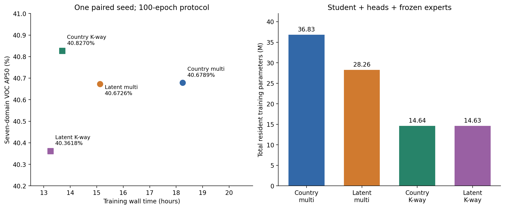
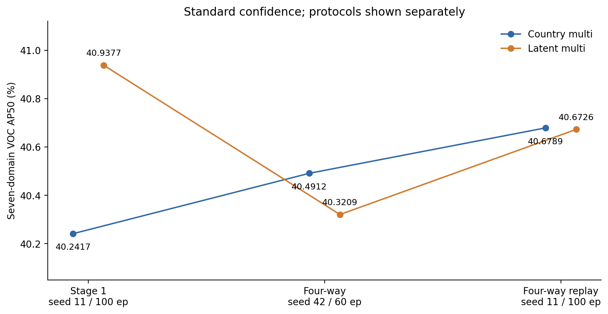

# 实验结果、复杂度与论文表述

本页使用标准类别置信度测试。主要效果指标为七域等权平均VOC mAP50；所有AP以百分数表示，差值以百分点pp表示。各表的训练协议和测试版本单独标识，不跨协议合并为多seed均值。

## 1. 第一阶段五组结果

权重来自`stage1-latent-domain/comparison_20261005_100ep/`，正式标准复测来自`test_comparison_standard_conf_20261006_201514/`，seed11、100轮。

| 实验 | 七域VOC AP50/% | 七域COCO AP50/% |
|---|---:|---:|
| baseline | 39.1011 | 38.8506 |
| country_repeat | 39.8351 | 39.4973 |
| latent_repeat | 40.3362 | 40.0321 |
| country_unique | 40.2417 | 39.9515 |
| latent_unique | 40.9377 | 40.6478 |

潜在域相对国家域的七域VOC提升：Repeat配对+0.5010 pp，Unique配对+0.6961 pp。后者控制了每轮图片和步数，但K、专家数及Triplet域池仍随划分改变。baseline是国家重复采样下仅检测，不能作为Unique预算下的严格仅检测对照。

## 2. 四组100轮结果与成本

来源：`stage2-k-way/kway_comparison_100ep_seed11_20261015/`；相同seed11、100轮余弦日程，四组分别单卡并行。

| 组 | 七域VOC/% | 七域COCO/% | 目标四域VOC/% | 训练/h | 总训练参数/M | best轮 |
|---|---:|---:|---:|---:|---:|---:|
| 01 国家多专家 | 40.6789 | 40.2848 | 27.7034 | 18.241 | 36.828 | 29 |
| 02 潜在多专家 | 40.6726 | 40.3850 | 27.2917 | 15.122 | 28.264 | 30 |
| 03 国家K-way | 40.8270 | 40.4057 | 27.6204 | 13.696 | 14.637 | 27 |
| 04 潜在K-way | 40.3618 | 40.0694 | 27.0712 | 13.247 | 14.629 | 25 |

| K-way与对应多专家比较 | 七域VOC变化/pp | 训练时间减少 | 总训练参数减少 | 平均训练步耗时 |
|---|---:|---:|---:|---|
| 03−01 国家域 | +0.1481 | 24.9% | 60.3% | 0.489→0.343秒 |
| 04−02 潜在域 | −0.3108 | 12.4% | 48.2% | 0.372→0.321秒 |

参数量为Student+判别器+冻结专家的**总训练驻留参数**，并非全部可训练参数。专家预训练成本未计入本轮壁钟；四组推理Student均11.137M参数。峰值显存约10.09～10.18GiB，没有显示与参数量成比例的下降。测试总耗时包含读取、推理、COCO/VOC计算和保存，不是纯推理延迟。

### 计算复杂度应怎样描述

设当前batch域样本数为$B_k$，$\sum_kB_k=B$。硬路由专家仅处理自己的子batch，因此专家前向总样本数是B，**不是每个专家都处理整个batch的KB**。多专家还需要每域判别器的Student前向、专家real前向、Student fake前向及相应反向；K-way将其替换为共享域头的一次联合前后向，并去掉专家前向。

驻留参数可写为：

$$P_{multi}=P_S+\sum_k(P_{E_k}+P_{D_k}),\qquad P_{kway}=P_S+P_{D^{(K)}}.$$

这是结构上的资源简化；实际FLOPs、算子效率、batch拆分、CPU/存储负载和频率状态共同决定壁钟时间。本项目没有完成统一FLOPs或纯推理基准，不应把实测时间变化写成普遍的K倍计算加速。

## 3. 60轮实验是另一套协议

seed42、60轮及60轮日程的标准复测位于S2-60的`testing_standard_conf_20261015_115715/`。其首次`testing/`使用了不确定性转换置信度，虽然配置标记写标准置信度，实际代码仍覆盖了分数。主表只采用单独标准复测：

| 组 | 七域VOC AP50/% | 七域COCO AP50/% |
|---|---:|---:|
| 01 国家多专家 | 40.4912 | 40.0217 |
| 02 潜在多专家 | 40.3209 | 39.8508 |
| 03 国家K-way | 39.9819 | 39.5962 |
| 04 潜在K-way | 39.9093 | 39.5130 |

它不是第一阶段100轮实验的截断版：seed改变分类输出层和D初始化、shuffle/增强；缩短日程改变前半程LR。不能把这套与100轮结果合并成配对多seed统计。

## 4. 第一阶段优势的复现状态

| 协议 | 国家多专家VOC/% | 潜在多专家VOC/% | 潜在−国家/pp |
|---|---:|---:|---:|
| 第一阶段，seed11、100轮 | 40.2417 | 40.9377 | +0.6961 |
| 四组，seed42、60轮 | 40.4912 | 40.3209 | −0.1704 |
| 四组重跑，seed11、100轮 | 40.6789 | 40.6726 | −0.0063 |

S2-100的01/02恢复了第一阶段记录的共同训练配置，差异仅实验名和GPU编号；相同确定性条件下三个真实batch的模型、EMA、判别器和损失逐项一致。但正式100轮轨迹从首轮就分叉，best轮次改变，终值及潜在域优势没有重复。

因此本项目已有**配置/方法复现证据**，还没有“潜在域七域优势稳定复现”的证据。正式运行启用cuDNN benchmark、GPU更换和后端数值路径是需要隔离的来源，不能把它们当作已经证明的全部原因。详见当前归档的[复现验收](../../stage2-k-way/kway_comparison_100ep_seed11_20261015/第一阶段复现验收.md)。

## 5. 论文可采用的表述

**方法描述：**

> 我们从源训练图像的冻结骨干提取通道均值和标准差，形成标准化的外观统计表示。基于候选K比较和重采样稳定性确定两个固定潜在域，并将其用于域条件的训练分组。进一步以单个K类域分类器及梯度反转，替换冻结专家和多个专家—学生判别器组成的对抗模块，保留检测与对象级度量约束。

**K-way结果描述：**

> 在seed=11、100轮的固定训练协议下，K-way替换使训练时间减少12.4%～24.9%，总训练驻留参数减少48.2%～60.3%，七域平均VOC mAP50相对对应多专家基线变化为−0.311至+0.148个百分点，体现了本轮观测中的精度与训练成本取舍。

**潜在域结果描述：**

> 初始五组实验中，潜在域Unique方案较国家域Unique方案提高七域VOC mAP50 0.696个百分点；同配方后续重跑的两组表现接近。潜在域收益的稳定性仍需固定协议的配对重复验证。

## 已知问题与证据边界

- 初轮K=2的无监督结构质量不等于下游检测最优；国家和语义组成仍与簇相关。
- 四组属于模块替换的2×2对照，不隔离专家移除、目标函数和更新方式各自的贡献。
- 小幅AP变化可以描述为本轮“精度接近”，没有预设非劣容差及重复运行方差，不能宣称统计等效或无损替代。
- 训练域分类准确率高不能作为对齐成功的证据；须结合域CE、平衡准确率及独立源验证探针。S2-60末轮国家/潜在K-way训练域平衡准确率约99.94%/96.29%，尤其国家分支域梯度衰减明显。
- 聚类、检测训练和标定均不读取目标测试数据；七域测试只能评价，不作为调参或checkpoint选择依据。
- 文档中的备选消融设计不是已经完成的实验，不应加入已完成结果表。

机器可读表见[tables](tables/)；每行均包含来源路径和协议字段。
