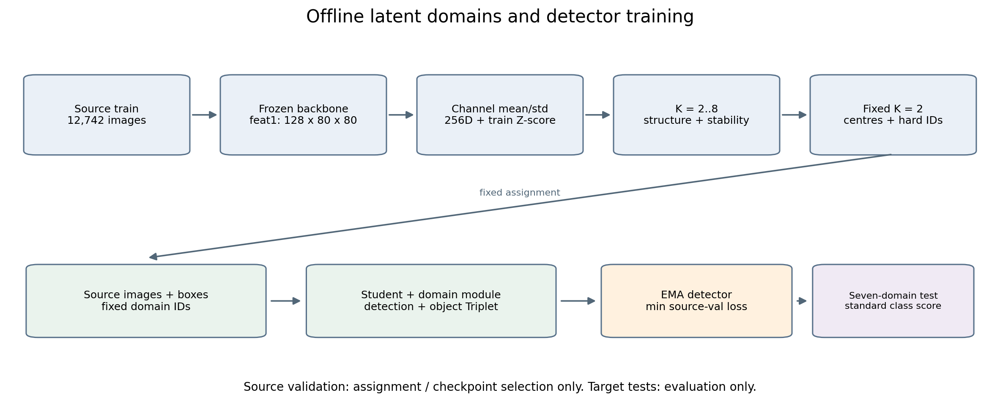

# 潜在域与 K-way 方法资料

本资料以当前归档目录、实际运行配置和代码快照为依据，覆盖离线潜在域发现、国家域/潜在域训练对照，以及多专家多判别器到单 K-way 域对抗模块的替换。主比较指标为**七个测试集等权平均 VOC mAP50**；COCO、源三域和未见四域结果单独列出。

| 要解决的问题 | 阅读入口 |
|---|---|
| 如何提取风格表示、选择 K、生成固定域标签 | [01 潜在域发现与训练](01_潜在域发现与训练.md) |
| 专家、判别器、GRL、Triplet 怎样连接及更新 | [02 K-way 替换方案](02_Kway替换方案.md) |
| 怎样在当前目录复现，后续怎样控制消融变量 | [03 复现与消融指南](03_复现与消融指南.md) |
| 哪些实验结果可比较，论文可以支持哪些结论 | [04 实验结果与论文表述](04_实验结果与论文表述.md) |
| 入口、核心函数、数据、权重、历史分支在哪里 | [05 文件索引与版本关系](05_文件索引与版本关系.md) |
| 数学动机与参考文献，哪些属于本项目的实现选择 | [06 理论依据与参考文献](06_理论依据与参考文献.md) |

## 三个阶段如何衔接




| 简称 | 当前项目相对路径 | 内容 |
|---|---|---|
| S0 | `stage0-latent_domain_analysis/` | 256维风格表示、K选择、稳健性、K=2标签和TXT |
| S1 | `stage1-latent-domain/comparison_20261005_100ep/` | seed=11、100轮、五组训练 |
| S1-T | `stage1-latent-domain/test_comparison_standard_conf_20261006_201514/` | S1原best权重的标准置信度复测 |
| S2-60 | `stage2-k-way/kway_comparison_60ep_seed42_20261014/` | seed=42、60轮四组；含第一次测试及单独标准复测 |
| S2-100 | `stage2-k-way/kway_comparison_100ep_seed11_20261015/` | seed=11、100轮四组及标准置信度测试 |

## 三个容易混淆的区别

- **聚类层与对抗层不同**：S0使用骨干feat1（128×80×80）的通道均值/标准差；正式多专家及K-way对抗接feat3（512×20×20），Triplet接feat3/feat2。
- **当前源码与历史运行入口不同**：根目录`train_style_adv.py`当前没有五组对照的提前分发逻辑；第一阶段的分发入口保存在S1的`source_snapshot`。根目录`README_style.md`描述更早的K=3软路由，不是本资料两条主线的配方。
- **方法复现与结果复现不同**：S2-100的01/02恢复了第一阶段配方，但未重复第一阶段潜在域在七域VOC上的+0.6961 pp优势。相关数值和证据在[04](04_实验结果与论文表述.md)集中说明。

## 图表与可复用产物

`figures/`保存PNG预览、PDF和SVG矢量图；`tables/`保存从归档指标导出的CSV；`tools/build_assets.py`只读取记录并重建图表，不进行聚类、训练或推理。

```bash
cd /data4/czh/yolov8-cluster/yolov8-hard-clustering
MPLBACKEND=Agg /data4/czh/anaconda3/envs/yolo_dg/bin/python docs/methods/tools/build_assets.py
```

资料核对日期：2026-10-16。历史JSON内的旧绝对路径是原运行记录；本文链接指向当前归档位置。当前目录搬迁产生的复现入口问题集中见[03的路径适配](03_复现与消融指南.md#当前目录的路径适配)。
