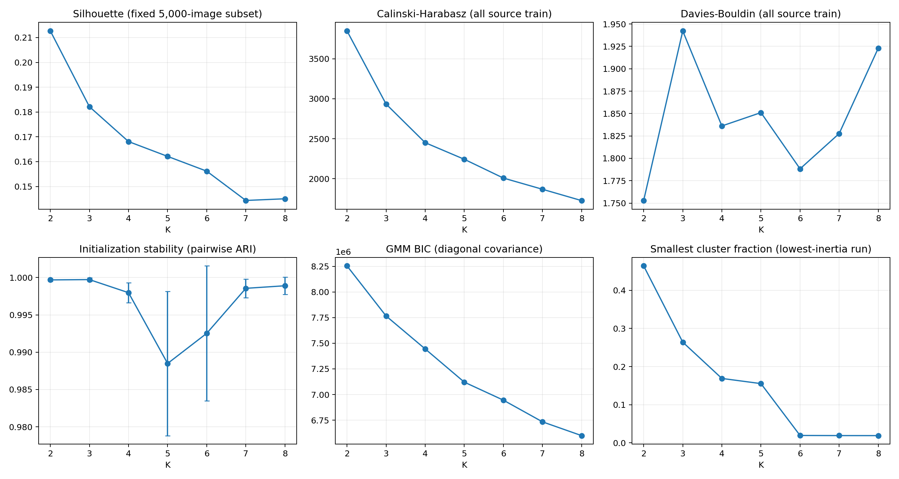

# 源域潜在域 K 选择报告

执行日期：2026-10-04。当前状态：**用户已确认 K=2；正式训练标签、验证标签及域清单已生成。** 初轮及补充实验的选择证据保留如下。

更新：已完成 10 组 5,000 图片评估子集及 10 组 80% 重采样稳定性验证。K=2 在两项实验中均为 10/10 次 Silhouette 第一；重采样运行间 ARI 为 0.991460 ± 0.003076。详见本文第 7 节及 [稳健性补充报告](robustness/稳健性补充报告.md)。

## 1. 本次实际执行

使用 India 2,578 张、Japan 6,320 张、United_States 3,844 张原始训练图片，共 12,742 张。不做国家均衡采样，不读取目标域或旧风格聚类产物。

固定加载本项目 `model_data/yolov8_s.pth`，162 个骨干权重张量严格匹配。输入 RGB、BICUBIC 直接缩放到 640×640、float32 /255；提取 P3/feat1（backbone.dark3）通道均值与标准差，得到 12,742×256 的矩阵。完整提取耗时约 153.75 秒。

全量 source train 特征拟合 Z-score。每个 K 五个种子、每个种子 n_init=10，共 35 次 K-means 调用。Silhouette 使用固定 5,000 张图片；CH、DB、簇占比用全量训练集。稳定性为每个 K 的十个两两 ARI。GMM 使用 diag 协方差、n_init=3，全部收敛。K 比较耗时见 `selection_complete.json`。

## 2. 定量结果

以下 Silhouette、CH、DB、ARI 为重复运行均值；完整标准差、每次运行及 GMM 收敛信息见 [汇总 CSV](k_selection_metrics.csv)、[逐次运行](k_selection_runs.csv)、[ARI 明细](stability_pairs.csv)。

| K | Silhouette ↑ | CH ↑ | DB ↓ | ARI ↑ | 最小簇占比 | GMM BIC ↓ |
|---|---:|---:|---:|---:|---:|---:|
| 2 | **0.212708** | **3848.98** | **1.752818** | 0.999686 | 46.41% | 8,254,296 |
| 3 | 0.182148 | 2934.11 | 1.942194 | 0.999730 | 26.41% | 7,765,687 |
| 4 | 0.168091 | 2451.31 | 1.836139 | 0.997975 | 16.90% | 7,444,392 |
| 5 | 0.162115 | 2243.80 | 1.851052 | 0.988486 | 15.54% | 7,120,714 |
| 6 | 0.156163 | 2009.04 | 1.788290 | 0.992526 | 1.95% | 6,944,935 |
| 7 | 0.144357 | 1868.90 | 1.827654 | 0.998558 | 1.91% | 6,733,525 |
| 8 | 0.145029 | 1727.31 | 1.923067 | 0.998902 | 1.91% | **6,599,292** |

**建议优先确认 K=2。** 它在主指标 Silhouette 上领先 K=3 约 0.03056，CH 和 DB 也支持 K=2。两个簇为 5,913 / 6,829 张，占 46.41% / 53.59%，没有小簇问题。ARI 约 0.9997，初始化稳定。

K=3 的 ARI 均值略高，但差异仅约 0.000044，在两者约 0.0002 的两两 ARI 波动范围内，不足以抵消其他指标的劣势。对于 K=2 和 K=3，各自五次运行在固定评估子集上的 Silhouette 均值完全一致；全量标签仍有少量差异，ARI 略低于 1。这种重复运行标准差不是跨数据集置信区间，也不等于重采样稳定性。

K=6～8 出现 243～248 张的小簇，约占 2%；它们高度集中于日本图片。该现象需要解释，不能直接将小簇认定为异常或认定更大 K 必然无效。

## 3. GMM-BIC 与 Gap 的处理

GMM-BIC 随 K 增加持续下降，支持更复杂的对角高斯混合模型；本候选范围内最低点在上边界 K=8，因此不能宣称它已经找到全局最佳分量数。GMM 分量数与 K-means 的硬潜在域数量并不必然相同。

初轮保留这一不同倾向，不把 GMM 结果强制转成硬聚类标签。按预先约定，Gap 仅在 Silhouette、CH、DB、Stability 明显冲突时补充；前三项均支持 K=2，初始化稳定性近似持平，因此初轮未触发 Gap。随后经用户确认，增加了第 7 节的评估子集与 80% 重采样验证，进一步支持 K=2。

## 4. K=2 的解释性检查

| 候选簇 | India | Japan | United_States | 合计 |
|---|---:|---:|---:|---:|
| 0 | 306 | 5,055 | 552 | 5,913 |
| 1 | 2,272 | 1,265 | 3,292 | 6,829 |

两个簇都含三个国家，每个国家也都分布在两个簇中；但簇 0 中日本占 85.49%，国家与聚类仍明显相关。不能声称已经获得与国家无关的纯风格划分。

从距中心最近的自动选图观察，簇 0 示例多为日本住宅道路，簇 1 示例多为美国较宽道路及部分印度道路。它们支持外观、取景和背景结构存在差异的解释；最近的九张图片不能代表簇内全部变化，也不能证明只编码了“风格”。

有效病害实例比例：

| 簇 | D00 | D10 | D20 | D40 |
|---|---:|---:|---:|---:|
| 0 | 28.10% | 22.41% | 36.41% | 13.09% |
| 1 | 42.51% | 20.24% | 18.35% | 18.90% |

两簇均含四种病害，但 D00、D20 比例存在明显差异。当前统计没有显示“一个簇只对应一个病害类别”，仍不能排除语义与国家组成的混杂影响。国家和类别均未输入 K-means。

PCA 前两维解释约 45.20% 方差，仅用于展示；聚类始终在标准化的 256 维空间进行。

- [K=2 国家组成图](../figures/candidate_analysis/k2/country_cluster_matrix.png)
- [K=2 病害分布图](../figures/candidate_analysis/k2/damage_distribution_by_cluster.png)
- [K=2 PCA](../figures/candidate_analysis/k2/pca_clusters.png)
- [簇 0 最近样本](../figures/candidate_analysis/k2/cluster_0_representatives.png)
- [簇 1 最近样本](../figures/candidate_analysis/k2/cluster_1_representatives.png)
- [K=3 国家组成对照](../figures/candidate_analysis/k3/country_cluster_matrix.png)
- [K=3 病害组成对照](candidate_analysis/k3/damage_distribution.csv)

## 5. 完整性与局限

- 权重、原始清单、特征与逐图片 metadata 均保存哈希。
- 全部 12,742 张图片保留；路径无重复，各国 train/val 无路径交叉。未进行图像内容去重。
- Japan_train 第 1983 行存在一个零宽度 D20 框。保留原标注，统计同时保存原始和有效实例数；有效比例排除该框，聚类不受该标注影响。
- 独立复核全部七组候选：每张图片的标签与其最近中心一致，inertia、簇数量和最低 inertia 候选选择一致；35 次运行、70 对 ARI 齐全。见 [verification.json](verification.json)。
- 未设置 FINAL_K 时，最终标签生成入口已验证会拒绝执行。
- Silhouette 约 0.213，说明 K=2 是本表示、本范围内的较优选择，不能据此宣称存在非常清晰的天然两类，也不能保证后续检测 mAP 最优。

## 6. 最终 K 确认及输出

用户在审阅初轮与稳健性结果后明确确认按 K=2 执行。`config.py` 已设置 `FINAL_K=2`，以已审阅候选的种子 2 重新拟合，标签和中心重现候选结果。

正式训练簇为 5,913 / 6,829 张；验证集以相同提取器重新提取特征，用训练集 scaler/中心分配为 738 / 854 张，未拟合验证集。训练、验证的单簇和合并 TXT 均放在独立目录。详见 [数据清单说明](../domain_splits/README.md)、[导出校验](../domain_splits/verification.json) 及 [确认记录](final_k_decision.json)。本阶段已完成，尚未训练专家或对抗模型。

## 7. 稳健性补充结果

本次补充仅使用已有 256 维特征与原标准化参数；原始初始化稳定性及候选均保留。两项扰动分开计算，标准差不作为置信区间。

| K | 10 组评估子集 Silhouette mean±std | 80% 重采样运行间 ARI mean±std |
|---|---:|---:|
| **2** | **0.213598 ± 0.002003** | **0.991460 ± 0.003076** |
| 3 | 0.183044 ± 0.002083 | 0.975600 ± 0.025456 |
| 4 | 0.168137 ± 0.002006 | 0.826395 ± 0.197513 |
| 5 | 0.160717 ± 0.001352 | 0.970468 ± 0.011312 |
| 6 | 0.153861 ± 0.001714 | 0.899069 ± 0.153393 |
| 7 | 0.145091 ± 0.001307 | 0.976521 ± 0.012226 |
| 8 | 0.145683 ± 0.001139 | 0.974772 ± 0.009808 |

- K=2 在 10 组评估子集上均排名第一，K2−K3 的 Silhouette 差值最小仍为 0.026441。
- 80% 重采样共完成 70 次拟合；每次为全部 12,742 张图片分配标签，计算 315 对 ARI。K=2 与原全量候选的平均 ARI 为 0.993576；编号对齐后的平均标签一致比例为 99.839%，这不是正确率。
- 在同一固定评估子集上比较 10 组重拟合，K=2 仍为 10/10 次 Silhouette 第一，均值为 0.212781 ± 0.000086。
- K=4 有 2 次、K=6 有 1 次重采样出现较大分组变化，说明初轮接近 1 的初始化稳定性不能代替数据扰动验证；这些运行全部保留。
- 20 组抽样索引、70 次最近中心分配、315 对 ARI 与汇总均通过独立校验；原始产物哈希不变。

这些结果增强了选择 K=2 的依据，尚不构成对下游检测效果的证明。用户随后已人工确认 K=2，正式输出见第 6 节。

[完整补充分析与文件说明](robustness/稳健性补充报告.md)
