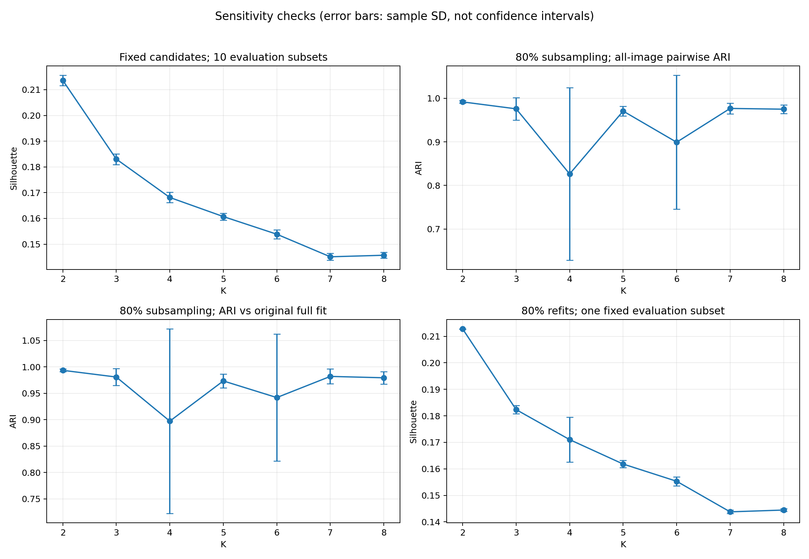

# K 选择稳健性补充报告

执行日期：2026-10-04。两项补充实验均已完成，CPU 计算及制图合计约 88.63 秒。**结果继续支持 K=2，并补充了评估抽样和拟合数据扰动下的证据。** 本实验运行时 FINAL_K 为 None；用户随后确认 K=2，正式划分见 [数据清单说明](../../domain_splits/README.md)。

## 1. 实验边界与公平性

- 全程复用 12,742×256 原始特征及原全量 source-train 标准化参数，不重新提取特征，不读取目标域，不训练模型，不做国家均衡。
- 保留初轮初始化稳定性；本报告新增的 subsampling stability 单独保存，不覆盖初轮结果。
- 两项实验分别改变评估样本和拟合样本，不把两种来源的波动混成一组 mean±std。
- 所有 K=2～8 共用每次抽样的索引，所有索引均已保存，可按种子复现。
- 标准差均为 ddof=1 的样本标准差；子集重叠、共享全量图片、两两 ARI 共享运行，因此这些值只描述波动，不作为独立重复实验的置信区间。

## 2. 10 组 5,000-sample subsets

种子 100～109，每组从全部训练图片中无放回抽取 5,000 张。每个 K 使用原全量拟合的候选标签，不重新聚类。各组内的 Silhouette 都基于该子集的标准化特征与欧氏距离。

| K | Silhouette mean ± std | 最小值 | 最大值 | 平均排名 | 排名第一次数 |
|---|---:|---:|---:|---:|---:|
| **2** | **0.213598 ± 0.002003** | 0.209281 | 0.216031 | **1.0** | **10/10** |
| 3 | 0.183044 ± 0.002083 | 0.179423 | 0.185784 | 2.0 | 0/10 |
| 4 | 0.168137 ± 0.002006 | 0.163836 | 0.171087 | 3.0 | 0/10 |
| 5 | 0.160717 ± 0.001352 | 0.157921 | 0.163045 | 4.0 | 0/10 |
| 6 | 0.153861 ± 0.001714 | 0.150075 | 0.155791 | 5.0 | 0/10 |
| 7 | 0.145091 ± 0.001307 | 0.143102 | 0.147191 | 6.8 | 0/10 |
| 8 | 0.145683 ± 0.001139 | 0.144245 | 0.147313 | 6.2 | 0/10 |

同一子集上的配对差值 Silhouette(K=2)−Silhouette(K=3)：

- 均值：0.030555；标准差：0.002918。
- 范围：[0.026441, 0.034803]，10/10 次均为正。
- K=2～6 的排序在全部子集上保持一致，K=7、8 有少量次序交换。

**解释：K=2 的领先没有依赖初轮那一组固定的 5,000 张图片。** 新均值 0.213598 与初轮 0.212708 的差异来自评估样本变化，不表示更改了原聚类结果。

明细：[逐子集评分及排名](silhouette_subset_runs.csv)、[汇总](silhouette_subset_summary.csv)、[K2−K3 配对差值](silhouette_k2_k3_differences.csv)。

## 3. 10 组 80% subsampling stability

种子 200～209，每组无放回抽取 round(12742×0.8)=10,194 张图片。每个 K 均固定 K-means seed=0、n_init=10、max_iter=300、tol=1e-4。每次只在该子集拟合中心，再对全部 12,742 张图片预测标签。

每个 K 的 10 次运行计算 45 对全量标签 ARI，共 315 对。另计算每次结果相对于原全量拟合候选的 ARI。

| K | 运行间 ARI mean ± std（45 对） | 运行间最低 ARI | 对原全量候选平均 ARI | 对原候选最低 ARI |
|---|---:|---:|---:|---:|
| **2** | **0.991460 ± 0.003076** | **0.982807** | **0.993576** | **0.989666** |
| 3 | 0.975600 ± 0.025456 | 0.918166 | 0.980879 | 0.939060 |
| 4 | 0.826395 ± 0.197513 | 0.555411 | 0.897368 | 0.563276 |
| 5 | 0.970468 ± 0.011312 | 0.951300 | 0.973488 | 0.953547 |
| 6 | 0.899069 ± 0.153393 | 0.587671 | 0.942010 | 0.601770 |
| 7 | 0.976521 ± 0.012226 | 0.944400 | 0.982063 | 0.948008 |
| 8 | 0.974772 ± 0.009808 | 0.947176 | 0.979468 | 0.955142 |

### K=2：对训练样本变化也稳定

按最大重叠将编号对应到原候选后，与原候选标签的平均一致比例为 **99.839%**，最低为 **99.741%**。这是一致性，不是真实域标签准确率。

对全部图片的分配数量，簇 0 在 5,881～5,929 张之间变化，簇 1 在 6,813～6,861 张之间变化，未出现某次重采样导致簇规模剧变。

### K=4、K=6：初轮初始化稳定没有暴露的敏感性

- K=4 在第 2、5 次重采样（种子 201、204）中，相对原候选 ARI 分别约为 0.5692、0.5633；全量标签及簇占比发生较大变化。
- K=6 在第 2 次重采样（种子 201）中，相对原候选 ARI 约为 0.6018。
- ARI 本身不受编号交换影响，而且占比图已经做了编号对齐，因此这不是簇编号互换造成的假象。
- 这说明在当前拟合流程下，这两个 K 对样本组成变化更敏感。固定随机种子和 n_init=10 不能证明每次都达到全局最优，因此目前不能进一步断定其变化完全来自数据本身，还是数据扰动与局部最优共同作用。

K=3、5、7、8 大体稳定，但 K=2 的运行间 ARI 及最差情况更好。

明细：[70 次拟合记录](subsampling_runs.csv)、[315 对 ARI](subsampling_pairwise_ari.csv)、[汇总](subsampling_summary.csv)、[对齐后的簇占比](subsampling_occupancy.csv)。

## 4. 重拟合后的 Silhouette 排名

为隔离拟合扰动，每次重拟合统一在初轮种子 3407 的固定 5,000 图片子集上评分。本节不使用第 2 节的 10 组不同评估子集。

| K | 重拟合后 Silhouette mean ± std | 第一名次数 |
|---|---:|---:|
| **2** | **0.212781 ± 0.000086** | **10/10** |
| 3 | 0.182347 ± 0.001541 | 0/10 |
| 4 | 0.171029 ± 0.008458 | 0/10 |
| 5 | 0.161820 ± 0.001344 | 0/10 |
| 6 | 0.155327 ± 0.001678 | 0/10 |
| 7 | 0.143788 ± 0.000648 | 0/10 |
| 8 | 0.144468 ± 0.000521 | 0/10 |

K2−K3 配对差值为 0.030434 ± 0.001551，范围 [0.029161, 0.034686]，10/10 次为正。K=4 个别重拟合的 Silhouette 高于同次 K=3，但始终低于 K=2。

**解释：不仅固定标签换评估样本仍支持 K=2，重新用 80% 数据拟合后，K=2 的优势也保留。**

## 5. 图表与审计

- [两种扰动的 K2−K3 配对差值图](../../figures/robustness/k2_k3_paired_differences.png)
- [编号对齐后的簇占比变化](../../figures/robustness/subsampling_occupancy.png)
- [完整协议](protocol.json)
- [独立校验](verification.json)

图中的误差条为 mean±std，有时算术上限超过 ARI 的理论上界 1，这不表示出现了大于 1 的原始 ARI，也不表示置信区间越界；原始取值请看 CSV。

校验覆盖：20 组索引的种子复现与无放回性质；70 次重拟合的全部图片最近中心分配；拟合 inertia；315 对 ARI 独立重算；编号对齐占比；汇总、排名、配对差值；两项直接欧氏 Silhouette 交叉检查。原始特征、标准化参数、候选和初轮指标哈希保持不变。

## 6. 更新后的判断与剩余边界

**建议仍为 K=2，现有证据比初轮更充分，支持在人工确认后进入最终硬标签生成。** 本轮没有改变特征表示、数据比例或目标函数来迎合 K=2，也没有因个别不稳定运行而删除或重做它们。

结论仍限定于当前特征、数据混合比例和 K=2～8 范围。它没有证明天然只有两种风格，没有消除国家/类别相关性，也没有验证检测 mAP。标准化参数固定且评分图片与拟合样本重叠，本实验是条件稳定性分析，不是独立留出集泛化评估；十组重叠子集也不相当于十个独立数据集。

本实验完成时保留 `FINAL_K=None`，没有自动确认。用户随后明确确认 K=2，现已生成正式训练/验证标签和 TXT；初始化与重采样结果保留，不进入专家或对抗训练。
