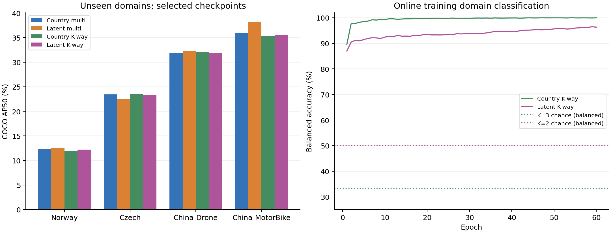
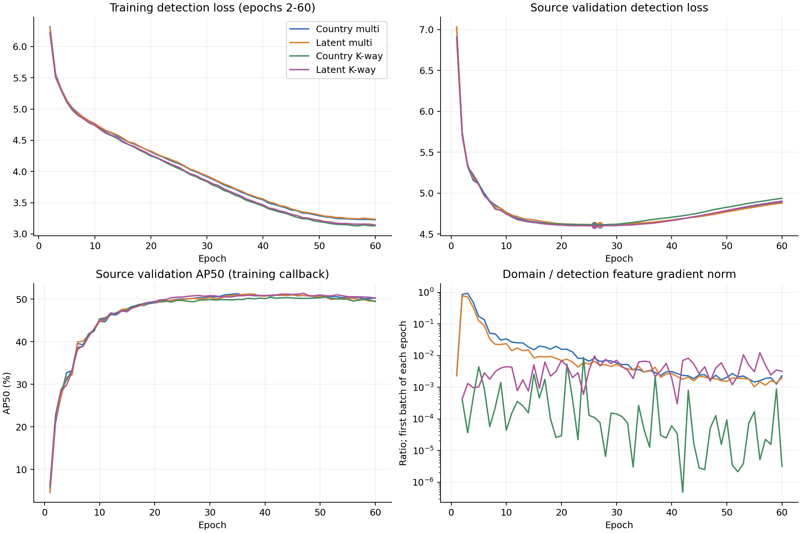

# 四组 60 轮实验结果分析

潜在域多专家多判别器取得本轮最高未见域平均精度：COCO AP50 为 **26.382%**，AP50:95 为 **10.166%**。相对国家域多专家组，平均 AP50 提高 **0.488 pp**，训练耗时减少 **15.2%**。K-way 将训练耗时进一步压缩到约 8 小时，但本轮未取得平均 AP50 提升，其主要价值是训练效率。

## 实验口径

四组均完成 60 轮；每轮记录 12,742 张训练图、1,592 张源验证图，共 1,062 步。每组完成七域、9,433 张图的测试。使用相同 seed=42、初始 YOLOv8-s 权重、640 输入、总 batch=12、Unique 数据协议。运行配置记录的训练与验证样本顺序一致。

权重按**最低源验证检测损失**选择，多专家组均选中第 27 轮，K-way 组均选中第 26 轮。测试数字来自这些权重，而非第 60 轮。主指标是 Norway、Czech、China-Drone、China-MotorBike 四域的等权平均；不是按图片数加权，也不是合并所有检测后重新计算的 AP。

所有 AP 为百分数；差值用百分比点 pp 表示。数据来自各组 `run_config.json`、`best_checkpoint.json`、`metrics/metrics_epoch.csv`、`epoch_audit.jsonl`、`gradient_checks.jsonl` 和七域 `testing/*/metrics.json`。

## 精度与训练成本

| 组别 | 未见域 AP50 | 未见域 AP50:95 | 源域 AP50 | 选中轮次 | 训练耗时/h | 步均时/s | 训练总参数/M |
|---|---:|---:|---:|---:|---:|---:|---:|
| 01 国家多专家 | 25.894 | 9.959 | **56.777** | 27 | 14.657 | 0.684 | 36.828 |
| 02 潜在多专家 | **26.382** | **10.166** | 56.270 | 27 | 12.430 | 0.545 | 28.264 |
| 03 国家 K-way | 25.688 | 9.986 | 56.101 | 26 | 8.472 | 0.368 | 14.637 |
| 04 潜在 K-way | 25.743 | 10.121 | 56.135 | 26 | **8.142** | **0.340** | **14.629** |

训练总参数包含冻结专家；四组部署的检测 Student 均为 11.137M 参数。

| 成对比较 | 未见域 AP50 差值/pp | AP50:95 差值/pp | 训练耗时变化 | 总训练参数变化 |
|---|---:|---:|---:|---:|
| 02 − 01：多专家下改用潜在域 | +0.488 | +0.207 | −15.2% | −23.3% |
| 03 − 01：国家域改用 K-way | −0.205 | +0.027 | −42.2% | −60.3% |
| 04 − 02：潜在域改用 K-way | −0.639 | −0.044 | −34.5% | −48.2% |
| 04 − 03：K-way 下改用潜在域 | +0.054 | +0.135 | −3.9% | −0.1% |

国家 K-way 的训练壁钟加速为 1.730×，潜在 K-way 为 1.527×。步均时对应加速约 1.859×、1.602×。潜在 K-way 的 AP50:95 接近潜在多专家组，但 AP50 低 0.639 pp；两个指标的差距幅度不同，应分别报告。

本轮精度和训练成本的主要取舍落在 02 与 04：02 精度最高，04 训练最快。按已记录的四项平均精度指标和训练耗时比较，04 均优于 03；01 则保留源域平均 AP50 的优势。

## 收益来自哪些域

| 测试域 AP50 | 01 国家多专家 | 02 潜在多专家 | 03 国家 K-way | 04 潜在 K-way |
|---|---:|---:|---:|---:|
| Japan | **60.193** | 60.151 | 58.444 | 58.901 |
| India | **44.476** | 42.941 | 44.352 | 43.056 |
| United States | 65.663 | 65.718 | 65.506 | **66.450** |
| Norway | 12.323 | **12.515** | 11.872 | 12.234 |
| Czech | 23.464 | 22.508 | **23.497** | 23.267 |
| China-Drone | 31.848 | **32.320** | 32.028 | 31.938 |
| China-MotorBike | 35.939 | **38.183** | 35.355 | 35.531 |

02 相对 01 在四个未见域的变化依次为 **+0.192、−0.956、+0.471、+2.244 pp**。三个域上升，一个域下降，但 China-MotorBike 是平均提升的主要来源：去掉该域，另外三个域的平均变化为 **−0.097 pp**。因此本轮支持“潜在域多专家提高平均跨域检测精度”，收益具有明显的域差异。

China-MotorBike 的四类 AP50 都有提升：D00 **+0.756**、D10 **+2.962**、D20 **+2.054**、D40 **+3.206 pp**。China-Drone 的 D40 提高 **4.140 pp**，同时 D00 下降 **2.072 pp**。Czech 的损失主要发生在 D20（**−2.544 pp**）和 D40（**−2.828 pp**）。后续按域、按类检查这些样例，比只比较平均分更能定位泛化变化。

在 K-way 架构下，04 相对 03 的平均 AP50 仅提高 **0.054 pp**，远小于多专家架构下的 +0.488 pp；两种架构的潜在域收益差为 **−0.434 pp**。本轮潜在划分与多专家方案的组合表现更强。

Norway 是四组共同的低分域，AP50 仅 **11.872%–12.515%**。替换现有判别器没有明显改变这一瓶颈。

## 收敛与损失解释

| 组别 | 最低验证检测 loss | 第 60 轮验证 loss | 相对最低值回升 | 选中轮训练检测 loss | 第 60 轮训练检测 loss |
|---|---:|---:|---:|---:|---:|
| 01 | 4.6039 | 4.8924 | +6.27% | 4.0288 | 3.2263 |
| 02 | 4.6126 | 4.8766 | +5.72% | 4.0383 | 3.2351 |
| 03 | 4.6121 | 4.9353 | +7.01% | 4.0044 | 3.1301 |
| 04 | 4.5993 | 4.9010 | +6.56% | 4.0122 | 3.1416 |

四组训练检测损失在选中轮后又降低约 **20%–22%**，验证损失却回升，呈现源验证检测损失意义上的过拟合。当前最低验证损失选权重的做法避开了末轮退化。

源验证 AP50 的最高点分别出现在第 **35、37、51、47** 轮，数值为 **51.278%、51.202%、50.468%、51.367%**。检测损失与 AP 的最优点并不重合。这些是训练回调的源验证 AP，其预测阈值等细节与正式测试不同，不能替代未见域测试结果。

当前打开的 `epoch_loss.txt` 记录的是训练**总损失**：

`L_total = L_detection + alpha_domain × L_domain + 0.3 × L_triplet`

多专家组 `alpha_domain=0.7`，域损失为 LSGAN 学生对专家目标；K-way 组约为 0.011995 / 0.012947，域损失为域标签交叉熵，Student 通过 GRL 获得反向梯度。因此第 60 轮 K-way 总损失更低（约 3.32/3.34，对比 3.60/3.63）不能直接证明检测效果更好。四组第 1 轮检测损失均约 95.8–95.9，第 2 轮总损失降到约 6.7–7.2；启动阶段的骤降是四组共有现象。

## K-way 的域混淆证据

| 诊断 | 03 国家 K-way | 04 潜在 K-way |
|---|---:|---:|
| 均衡准确率随机参考 | 33.33% | 50.00% |
| 选中轮在线训练域均衡准确率 | 99.81% | 93.32% |
| 第 60 轮在线训练域均衡准确率 | 99.94% | 96.29% |
| 选中轮域交叉熵 | 0.00659 | 0.15500 |
| 第 60 轮域交叉熵 | 0.00183 | 0.09172 |
| 选中轮首 batch 域/检测特征梯度范数比 | 0.0110% | 0.9733% |
| 第 60 轮首 batch 域/检测特征梯度范数比 | 0.000317% | 0.3170% |

域判别器仍能很容易识别训练样本的域标签。尤其国家 K-way 的交叉熵接近零，反传到共享特征的域梯度非常弱；这支持“分类器饱和、对抗影响衰减”的解释，现有证据不支持充分的域混淆。GRL 系数在选中轮末已达约 **0.974**，末轮约 **0.9999**，该现象不能简单归结为 GRL 尚未开启。

作为参照，第 20–60 轮每轮首 batch 的域/检测梯度比中位数，01/02/03/04 分别为 **0.271%、0.223%、0.00449%、0.444%**。国家 K-way 相对历史多专家方案的域梯度强度明显偏弱，而潜在 K-way 不呈现相同程度的衰减。因此只凭两个 K-way 系数都约为 0.012，无法判断二者训练期对抗效果相同。

系数来自初始化阶段固定源训练 batch 的梯度标定，这保证了标定时的尺度参照，不能保证整个训练期持续匹配。高在线训练域准确率也可能包含判别器记忆；要评价泛化意义上的域可分性，应对冻结 Student 特征训练探针并使用独立源验证样本评估。

## 结果边界与评估注意事项

- 本轮只有 seed=42，0.054–0.639 pp 的组间差值均为该次运行的观测结果，没有多 seed 方差或显著性结论。
- 多专家→K-way 同时移除了冻结专家，改变了对抗目标、GRL、权重和更新顺序；国家→潜在域还改变了域数、专家来源和 Triplet 挖掘池。四组比较的是完整方案，不能单独归因于判别器头数或聚类标签。
- 多专家 LSGAN 衡量学生/专家特征的真假区分，K-way CE 衡量域标签分类，两者原始 loss 不能横向比较。多专家判别器 loss 接近零同样不等于对齐成功。
- 峰值显存约 **10.09–10.18 GiB**，K-way 没有显示峰值显存下降；第 2–60 轮平均峰值约为 **5.99、5.93、5.80、5.80 GiB**。参数减少不能直接写成同比例显存节省。
- 四组都只部署检测 Student，训练总参数和七域测试壁钟耗时不能用于声称部署模型压缩或推理加速。测试耗时还包含数据读取、指标计算和写盘；四卡并行训练也受到共享资源影响。专家预训练耗时未计入本轮多专家训练成本。
- **28 份测试指标的固定阈值 P/R/F1 全为零**，其各类 TP、FP 也全为零；按当前评估逻辑，参与固定阈值统计的预测没有达到 0.5。AP 使用较低阈值保留的预测排序，故仍可非零。这些零值不能解释成没有检测能力，但表明当前 0.5 工作点无法使用；应检查置信度分布及解码口径，并在源验证集确定工作阈值。

## 后续实验取舍

**精度主线保留 02，效率主线保留 04。** 02 是本轮未见域 AP50 与 AP50:95 最优组；04 提供约三分之一训练时间节省，AP50:95 与 02 相差 0.044 pp。

1. 优先补充配对 seed。可用 42、43、44 作为起点，保持当前数据与最低源验证损失选权重规则，报告各域及四域平均值的均值、标准差；优先确认 02 对 01 的提升以及 04 对 02 的取舍是否稳定。
2. 若继续优化 K-way，先补同域划分、同 Triplet 的 `alpha_domain=0` 对照，判断当前对抗分支相对“检测+Triplet”是否带来实际收益。再根据训练期梯度和源验证表现设置少量系数候选，重点处理国家 K-way 的梯度衰减；不根据目标测试分数调参。
3. 在独立源验证样本上评估冻结特征域探针，并检查 Norway、Czech D20/D40、China-MotorBike 的误检漏检。这样能区分域可分性、类别变化与置信度工作点的问题。
4. 沿用当前 60 轮学习率日程时，可考察带足够耐心值的源验证早停；若改成 30–40 轮并同时缩短余弦日程，应作为新设置评估，不能假定复现当前第 26–27 轮权重表现。

诊断数表见 [analysis/diagnostics.csv](analysis/diagnostics.csv)。图表提供同名 PNG/PDF，可通过 `python analysis/analyze_results.py` 从原始记录重新生成。
